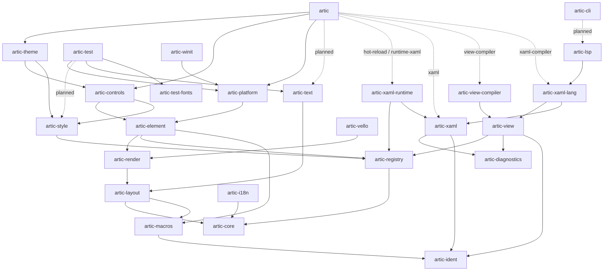

# Architecture

artic is a Cargo workspace of layered crates. This document is the reference for which crate may depend on which. The design behind each crate is in the [technical spec](spec/technical_spec.md).

## Seams

An app picks three things. Each sits behind an interface no layer below it knows the other side of.

| Seam | Interface | v1 |
| --- | --- | --- |
| Host | `Host` in `artic-platform` | `artic-winit` |
| Renderer | `Renderer` in `artic-render` | `artic-vello` |
| UI language | `Document` and `Language` in `artic-view`, over the registry and the tree, as [the contract](spec/dsl.md) states | XAML: `artic-xaml`, `artic-xaml-lang`, `artic-xaml-runtime` |

No crate below a UI language depends on it or names it. Only the XAML crates (`artic-xaml`, `artic-xaml-lang`, `artic-xaml-runtime`), `artic-lsp`, `artic-cli`, the facade's `xaml` module and `docs-check`'s list of documents say XAML or write its `x:` directives; `scripts/check-ui-neutral.sh` checks this in CI.

## Layers

A crate's layer is its depth: one more than the deepest artic crate it depends on, planned dependencies included, and 0 for a crate with none. So a crate depends only on crates in lower layers, and crates in the same layer never depend on each other.

| Layer | Crates | Role |
| --- | --- | --- |
| 0 | `artic-core`, `artic-diagnostics`, `artic-ident`, `artic-test-fonts` | Foundations with no artic dependencies: the reactive core and tree, spans and diagnostics, Rust identifier rules, and the test font |
| 1 | `artic-macros`, `artic-registry`, `artic-i18n`, `artic-xaml` | The proc macros, type metadata, localization, the XAML parser |
| 2 | `artic-layout`, `artic-style`, `artic-view`, `artic-xaml-runtime` | Geometry, layout and text values; styling; the view every UI language reads into, and its checks; the XAML loader |
| 3 | `artic-render`, `artic-text`, `artic-view-compiler`, `artic-xaml-lang` | The `Renderer` seam and scene; text shaping and fonts; the compiler every UI language uses; XAML as a UI language |
| 4 | `artic-element`, `artic-vello`, `artic-lsp` | The `Element` trait, its contexts and the property groups every control has; the default renderer adapter; the language server |
| 5 | `artic-controls`, `artic-platform`, `artic-cli` | Controls, the `Host` seam and frame pipeline, and the CLI |
| 6 | `artic-theme`, `artic-test`, `artic-winit` | The default theme, test utilities, and the default host adapter |
| 7 | `artic` | The facade that apps depend on |

## Dependency graph

Arrows point from a crate to its dependency. A dotted arrow is optional (named by its feature) or planned.



The graph omits edges that a lower edge already implies (for example `artic-controls -> artic-core`). The full list of direct dependencies:

| Crate | Depends on |
| --- | --- |
| `artic-core` | none |
| `artic-macros` | `artic-ident` (proc-macro; generated code names `artic::__private`, `artic_registry::__private` or, for `UiEnum`, `artic_core::__private`, whichever the calling crate depends on) |
| `artic-diagnostics` | none |
| `artic-ident` | none |
| `artic-xaml` | `artic-diagnostics`, `artic-ident` |
| `artic-test-fonts` | none (data only: the test font's bytes) |
| `artic-registry` | `artic-core` |
| `artic-layout` | `artic-core`, `artic-macros` |
| `artic-i18n` | `artic-core` |
| `artic-render` | `artic-core`, `artic-layout` |
| `artic-text` | `artic-layout` |
| `artic-style` | `artic-core`, `artic-registry` |
| `artic-view` | `artic-registry`, `artic-diagnostics`, `artic-ident` |
| `artic-view-compiler` | `artic-view`, `artic-registry`, `artic-diagnostics` |
| `artic-xaml-lang` | `artic-xaml`, `artic-view`, `artic-registry`, `artic-diagnostics` |
| `artic-xaml-runtime` | `artic-xaml`, `artic-registry`, `artic-core` |
| `artic-element` | `artic-core`, `artic-registry`, `artic-layout`, `artic-render`, `artic-macros` |
| `artic-controls` | `artic-core`, `artic-registry`, `artic-layout`, `artic-render`, `artic-element`, `artic-style`, `artic-macros` |
| `artic-platform` | `artic-core`, `artic-layout`, `artic-render`, `artic-element` |
| `artic-cli` | `artic-xaml`, `artic-xaml-lang`; planned: `artic-lsp` (shared source index for `check` and `lsp`) |
| `artic-lsp` | `artic-xaml`, `artic-xaml-lang` |
| `artic-theme` | `artic-controls`, `artic-style` |
| `artic-test` | `artic-core`, `artic-layout`, `artic-render`, `artic-text`, `artic-test-fonts`, `artic-element`, `artic-platform`; planned: `artic-registry`, `artic-style` |
| `artic-winit` | `artic-core`, `artic-render`, `artic-platform` |
| `artic-vello` | `artic-layout`, `artic-render` |
| `artic` | every app-facing crate; `artic-xaml` with the `xaml` feature, which `hot-reload`, `runtime-xaml` and `xaml-compiler` turn on; `artic-xaml-runtime` only with `hot-reload` or `runtime-xaml`; `artic-view-compiler` with `view-compiler`, which `xaml-compiler` turns on; `artic-xaml-lang` only with `xaml-compiler`, which an app enables on its build-dependency on the facade |

## Rules

- `artic-controls` does not depend on `artic-platform`. Input event types live in `artic-core`, and the facade connects the platform host to the tree. Controls stay testable without a window and portable to future targets.
- The `Element` trait and its contexts (`RenderCx`, `HitTestCx`, `EventCx`, `AccessCx`) live in `artic-element`, together with gesture recognizers. `Application` and `Surface`, the roots the host presents, live there too, with the `Desktop` attached properties, so `artic-platform` reads them directly ([surface design](design/surface.md)). Controls implement `Element`; the platform host drives any `dyn Element` without knowing the concrete controls. The property groups every control has (`Layout`, `Appearance`, `Interaction`, `Identity`) live there too, so a control library outside artic doesn't need `artic-controls` and its built-in controls; `#[element]` stays with the macros.
- `artic-layout` defines `Layoutable`, `MeasureCx`, `ArrangeCx` and `LayoutManager` over `Layoutable`; `Element` extends `Layoutable`, so layout never names `Element`. Text measurement reaches layout through `TextEngine`, a trait defined in `artic-layout` and implemented by `artic-text` with `parley`, the same for every renderer. The shaped `Paragraph` is an `artic-layout` type too, so the scene carries it and renderers draw it without depending on `artic-text` ([text design](design/text.md)).
- `artic-platform` owns the frame pipeline (dispatcher, style pass, layout, scene build, render, accesskit). Stages that need crates the platform cannot see, such as the style pass or OS theme → root pseudo-classes, are registered as hooks by the facade. The platform never depends on `artic-style`, `artic-controls` or `artic-theme`.
- Tree behaviours that call `Element` (routed-event dispatch, hit testing, focus navigation) live in `artic-element`; `artic-core` keeps only the data types they use.
- OS services that controls use (clipboard, IME requests, cursor) are traits in `artic-core`. Hosts provide them as capabilities on `HostContext` ([host design](design/host.md)), the facade registers them, and controls reach them through their context or app services, never through the `Host`.
- Code that needs concrete controls but serves the runtime or tooling (hot-reload overlay and state restore, debug overlay) lives in the facade.
- Dev-dependencies may point from any crate to `artic-test`, as long as `artic-test` does not depend back on that crate. Control, theme and language-server tests use `TestHost` this way.
- Test data that a crate below `artic-test` needs too, such as the test font, lives in a data-only crate with no dependencies (`artic-test-fonts`), not in `artic-test`, so the crate's tests can use it without a cycle.
- The crates under `crates/artic-registry/fixtures/` are test-only (`publish = false`) and sit outside the layers. Two register two UI types each (`Alpha` or `Beta`, and `Twin`); `artic-registry-linking` holds the tests that check which of them reach the registry.
- `artic-xaml-lang`'s tests dev-depend on `artic-view-compiler`, in its layer, and on the facade (`xaml`, `view-compiler`), whose real paths its snapshots pin. Cargo allows these dev-only loops: `artic-xaml-lang` itself depends on neither, and the facade depends on it only with `xaml-compiler`.
- The crates under `crates/artic-xaml-lang/fixtures/` are test-only (`publish = false`) and sit outside the layers: `app` compiles its views from its build script through the facade, and `controls` is a control crate its map names and no view uses.
- `artic-macros`' own tests dev-depend on crates that use the macros, such as `artic-core`, `artic-registry` and `artic-element`. Cargo allows these dev-only loops: `artic-macros` itself depends only on `artic-ident`, so its build has no cycle.
- Rust identifier rules (snake, screaming snake and Pascal case, keywords, what an identifier is, and how a name is written as one) live in `artic-ident`, below every crate that writes Rust from a name, so each converts and checks a name the same way.
- Spans and diagnostics live in `artic-diagnostics`, below every UI language, so `artic-style` can report selector errors with spans without naming one.
- `crates/docs-check` is test-only (`publish = false`) and sits outside the layers, like the registry fixtures. It compiles the Rust code in the documents.
- `artic-xaml` does not depend on the registry. Type references stay unresolved in the infoset, so parser tests need no registry.
- Release builds link `artic-xaml-runtime` only when the app enables `runtime-xaml`. Compiled views never touch the loader.
- App-facing crates stay free of native-only dependencies, so a web target can be added later without app changes (D24 in the spec).
- Backend adapters (`artic-winit`, `artic-vello`, and any third-party adapter) depend only on the public API of `artic-render` and `artic-platform`. Nothing in artic depends on an adapter: each target's launcher names its host and renderer ([backend design](design/backends.md)). `artic-render` and `artic-platform` have no backend dependencies (`wgpu`, `vello`, `winit` and the OS crates live in adapters). An adapter's tests may dev-depend on `artic-controls` for control goldens, since goldens belong to each renderer ([golden images](design/golden-images.md)); its library still depends only on `artic-render` and `artic-platform`.

## Why this differs from the original §2 diagram

The first version of the spec drew `artic-core -> artic-layout -> artic-controls -> artic-style/platform/render`. Read with the stated arrow direction, that makes the core depend on layout and layout depend on controls, which contradicts "each layer depends only on the ones below it". The graph above is the corrected version, and the spec now points here.

## Checking the graph

```sh
cargo tree -e normal --workspace --depth 1
```

Every crate's direct dependencies must match the table above. A pull request that adds an edge updates this document in the same change.
