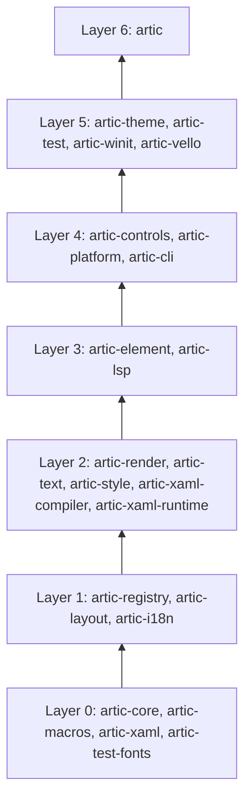
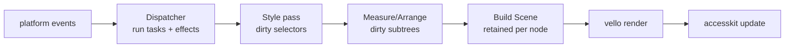
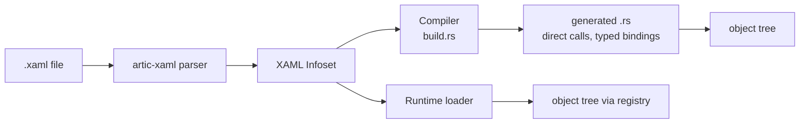

# artic — Technical Specification

Sep 23, 2026 · @Mariano

This revision applies the v1 planning decisions D1 to D28 recorded in issue #1. Decision IDs appear next to the text they changed. Work is tracked in the milestones M0 to M8 (§13).

## 1. Overview and locked decisions

A cross-platform desktop and mobile UI framework where views are written in XAML (a defined subset of [MS-XAML 2012](https://learn.microsoft.com/en-us/openspecs/microsoft_domain_specific_languages/MS-MSDLLP/69a08c4f-e943-4729-be0d-1b33d4ad967e) with an Avalonia-style vocabulary) and all logic is Rust. **The framework is named artic (artic.rs); crates are prefixed artic-**. XAML is artic's first UI language. The layers below it don't depend on it or name it, and [the UI language contract](dsl.md) states what any other language follows.

### Goals

- XAML that a WPF/Avalonia developer can read and mostly write without retraining.
- Rust-native, not .NET-on-Rust: composition and traits instead of class hierarchies, generics and concrete enums instead of \`dyn Any\`, std traits (\`FromStr\`, \`TryFrom\`, \`Result\`) instead of framework-specific converter and exception APIs, tree ids instead of shared mutable references. String-keyed lookup exists only where a UI language needs it and only in the hot-reload loader.
- Same pixels on Windows, macOS, Linux, iOS, and Android via one GPU renderer; layouts adapt to screen class and input mode, not to OS.
- Compiled XAML for release (type-checked, zero parse cost at startup) and interpreted XAML in development (hot reload).
- Fine-grained reactivity underneath; MVVM ergonomics (observable view-models, `{Binding}`) on top.

### Non-goals for v1

- Web/WASM. No v1 work targets it, but a later version must be able to add it without changing app code (D24). App-facing APIs never name `wgpu`, `vello`, `skia-safe` or `winit` types, the app entry point works on hosts whose event loop cannot block, services that are async on the web (clipboard reads, file dialogs) are async from v1, and the portable crates are checked against `wasm32-unknown-unknown` in CI.
- Native-looking widgets. Controls are templated and drawn by the framework; one default theme ships.
- Full MS-XAML conformance. Unsupported constructs are listed in §4 and produce compile errors, not silent behavior.
- DataGrid, TreeView, Menu bar controls, dialogs, `SplitView`, `Expander` (v2). A Rust-only view API (views built in code without XAML) is v2, but v1 must not preclude it: the control structs and `Property<T>` fields are the API. The v2 API is a builder (`Button::new().content("Hi").on_click(...)`); in v1 the derive already generates the builder methods and the XAML compiler emits builder calls (D8).
- CSS-syntax stylesheets (v2). v1 styles are written in XAML or with the builder API; a later CSS-syntax front end compiles to the same `Style`/`Setter` model, so v1 must keep that model independent of XAML syntax (§8, D28).

### Locked decisions

| Area | Decision |
| --- | --- |
| XAML dialect | MS-XAML 2012 syntax; Avalonia-style vocabulary and CSS-like selectors |
| Rendering | Behind a `Renderer` trait any adapter crate can implement; v1 ships `artic-vello` (`vello` on `wgpu`) |
| Windowing | Behind a `Host` trait any adapter crate can implement; v1 ships `artic-winit` on all five targets; mobile lifecycle (suspend/resume, surface loss, safe areas) is part of that trait |
| UI language | Pluggable, like the host and the renderer: a language builds the tree through the registry, following [the contract](dsl.md); v1 ships XAML. No crate below a language names it (#305) |
| Platforms v1 | Windows 10+, macOS 12+, Linux (X11 + Wayland), iOS 15+, Android 8+ (API 26) with Vulkan 1.1; one app crate, one binary per target |
| XAML loading | Both: build-time compiler (`build.rs`) and runtime loader, both driven by one generated type registry. The loader ships in release only with the opt-in `runtime-xaml` feature (D23) |
| Reactivity | Signals (fine-grained, synchronous, glitch-free) as the primitive and public API; `#[derive(ViewModel)]` and typed `{Binding}` on top, with no reflection in any build (D1, D6) |
| Styling | Avalonia-style selectors (`Button.primary:pointerover > TextBlock`) with `Setter`s, matching exact Rust types; no WPF triggers (D3) |
| Default theme | `artic-theme` (`<ArticTheme/>`): token based, with color, spacing, radius, shadow and type scales (D18) |
| Control set v1 | Panels, TextBlock, TextBox, Button, ToggleButton, CheckBox, RadioButton, Slider, ScrollViewer, ItemsControl, ListBox, ComboBox, TabControl, Border, Image, ContentControl, page-stack navigation (D7) |
| Events | Both `x:Class` code-behind handlers and MVVM commands/bindings |
| Async | Runtime-agnostic: framework owns a single-threaded UI executor; `spawn_blocking`/background work goes to whatever the app chooses |
| Accessibility | `accesskit` from day one; every visible control exposes a node (desktop adapter in M1, mobile in M7, D10) |
| Tooling | `cargo artic` CLI and the `artic-lsp` language server with a VS Code extension, both working from Rust source without a build (D21, D22) |
| License | `MIT OR Apache-2.0` (D13) |
| Minimum Rust | Stable, edition 2024 |

## 2. Architecture and crate layout

The framework is a Cargo workspace of layered crates; each layer depends only on the ones below it, and the XAML pipeline sits beside the runtime, not inside it.



Each layer builds on the ones below it. The exact dependency edges and the rules behind them (for example, `artic-controls` never depends on `artic-platform`) are in [docs/architecture.md](../architecture.md). The app crate depends on the compiler only as a build-dependency.

| Crate | Responsibility | Key public types |
| --- | --- | --- |
| `artic-core` | Signals, effects, `Property<T>`, styled-property metadata, visual/logical tree, `Object` trait, resources, dispatcher | `Signal`, `effect`, `Property`, `Node`, `UiTree`, `Dispatcher` |
| `artic-registry` | Type descriptors any UI language uses: type name → constructor, properties, content, attached properties, events, value providers; a type's namespace is its crate | `TypeInfo`, `PropertyInfo`, `Registry`, `Lookup` |
| `artic-macros` | `#[derive(UiType)]`, `#[element]`, `#[derive(UiProperties)]`, `#[derive(UiEnum)]`, `#[derive(ViewModel)]`, `#[ui_class]`, `xaml!` (inline) | proc macros |
| `artic-xaml` | Parser: XML → XAML Infoset (MS-XAML §5), markup-extension grammar, diagnostics with spans | `XamlDocument`, `XamlNode`, `MarkupExtensionAst`, `Diagnostic` |
| `artic-xaml-compiler` | Infoset → Rust source (`build.rs` API and `cargo artic` CLI) | `compile_dir()`, `CompileOptions` |
| `artic-xaml-runtime` | Infoset → live object tree using the registry; file watcher and hot-swap | `XamlLoader`, `HotReload` |
| `artic-layout` | Measure/arrange protocol, invalidation; the text values layout and renderers share, and the `TextEngine` seam | `Layoutable`, `MeasureCx`, `ArrangeCx`, `LayoutManager`, `Size`, `Rect`, `Thickness`, `TextEngine`, `FontFamily`, `TextStyle`, `Paragraph` |
| `artic-element` | The `Element` trait and its render, hit-test, event and accessibility contexts; the property groups every control has; gesture recognizers. Shared by controls and the platform host (D25) | `Element`, `Layout`, `RenderCx`, `EventCx`, `AccessCx` |
| `artic-controls` | Templated controls, primitives, panels, default `ControlTemplate`s | `Button`, `TextBox`, `ItemsControl`, … |
| `artic-style` | Selector parser and matcher, `Style`, `Setter`, pseudo-classes, resource dictionaries, theme switching | `Selector`, `Style`, `ResourceDictionary` |
| `artic-render` | `Renderer` trait, scene graph (display list), `Target`. No backend dependencies | `Renderer`, `Scene`, `Target`, `DrawingContext` |
| `artic-text` | Text shaping and line breaking via `parley`, system fonts via `fontique` | `Engine` |
| `artic-platform` | `Host`, `AppHandler` and `HostContext` with its capabilities, `artic::run`, frame pipeline (with facade-registered hooks). No backend dependencies | `Host`, `AppHandler`, `HostContext`, `SurfaceInfo` |
| `artic-winit` | Adapter: the desktop and mobile `Host` on `winit`, with `muda`, `rfd`, `arboard`, `accesskit_winit` | `Host` |
| `artic-vello` | Adapter: the default `Renderer`, `vello` on `wgpu` | `Renderer` |
| `artic` | Facade re-exporting the public API with feature flags (`xaml`, `hot-reload`, `runtime-xaml`) | `App`, `prelude`, `run`, `xaml::namespaces` |
| `artic-theme` | Default theme: token dictionaries (light, dark, touch density) and the default `ControlTemplate` for every v1 control (D18) | `ArticTheme` |
| `artic-i18n` | Optional fluent-rs implementation of the `Localizer` trait (D6) | `FluentLocalizer` |
| `artic-test` | Dev-dependency test utilities: `TestHost`, headless tree helpers, tree serializer (D14) | `TestHost` |
| `artic-test-fonts` | The test font's files and licence as byte constants, with no dependencies, so `artic-text`'s tests and `artic-test` share one copy | `REGULAR`, `BOLD` |
| `artic-cli` | `cargo-artic` binary: `check`, `new`, `schema`, `inspect`, `ios`, `android`, `lsp` (D15) | CLI |
| `artic-lsp` | Language server: source-based type index, diagnostics, completion, hover, navigation, formatting, rename (D21, D22) | `Server` |

### Seams

An app picks three things. Each sits behind an interface no layer below it knows the other side of.

| Seam | Interface | v1 |
| --- | --- | --- |
| Host | `Host` in `artic-platform` | `artic-winit` |
| Renderer | `Renderer` in `artic-render` | `artic-vello` |
| UI language | the registry and the tree, as [the contract](dsl.md) states | XAML: `artic-xaml`, `artic-xaml-compiler`, `artic-xaml-runtime` |

### Object model in one paragraph

Every UI element is a Rust struct stored in a generational arena (`UiTree`) and referenced by a `NodeId`; there is no `Rc<RefCell<>>` in the tree. Element structs implement the `Object` trait (registry lookup, property bag access) and `Element` (layout, render, input). Properties are `Property<T>` fields (§6) whose values are signals, so a binding, a style setter, and a direct set all write through the same path and invalidate the same dependents.

### Frame pipeline



Each stage runs only on nodes marked dirty by the previous one; a frame with no dirty nodes is skipped and the loop waits on the OS event queue.

## 3. Type system and registry

UI languages name types and properties by string; Rust doesn't. The registry exists to serve them, is generated entirely by derive macros, and is read at build time by a compiler, where every lookup turns into a direct, typed Rust call. Only a language's runtime loader keeps string keys alive when the app runs. [The UI language contract](dsl.md) states how a language uses it.

### Declaring a UI type

```rust,ignore
#[element]                                       // adds the four property groups, flattened, and derive(UiType)
#[derive(Debug)]
pub struct Border {
    #[ui(content)] pub child: Child,                 // the tree holds the child; the field marks it
    #[ui(affects = layout)] pub padding: Property<Thickness>,
    #[ui(affects = layout | render)] pub border_thickness: Property<Thickness>,
    #[ui(affects = render)] pub background: Property<Option<Brush>>,
    #[ui(affects = render)] pub border_brush: Property<Option<Brush>>,
    #[ui(affects = render)] pub corner_radius: Property<CornerRadius>,
    #[ui(affects = render)] pub box_shadow: Property<Option<BoxShadow>>,
}
```

The derive emits a `TypeInfo` static and registers it with `linkme` (distributed slice) so the registry is assembled at link time. It also writes the type's `Default` (each property created with its key and default) and `Object` impls, so the struct derives `Debug` but not `Default`. Field types decide everything: a `Property<T>` is a settable property if `T: FromStr` or `T: UiType` (looking through `Option`, and `NodeId` marks a child slot); an `Event<A>` is an event; a `#[ui(flatten)]` field is a property group (`#[derive(UiProperties)]`, such as `Layout`) whose properties are listed as the type's; any other `#[ui]` field must implement `UiCollection` and accepts child elements. `#[ui(content)]` marks the one property or collection field that receives content written inside the element (a flattened group may mark one of its properties instead), and `#[ui(override_defaults)]` on the struct makes `Default` call the type's `OverrideDefaults` impl after building the fields.

Each property gets its own `PropertyKey` unless `#[ui(key = FONT_SIZE)]` names a shared one; properties that inherit across types share their key. `affects = layout | render` and `inherits` set the metadata of a generated key.

### What the registry records

| Item | Fields | Consumer |
| --- | --- | --- |
| `TypeInfo` | name, Rust path (its first segment is the namespace, `TypeInfo::namespace()`), `new: fn(&mut UiTree) -> NodeId`, content (`ContentInfo`: a property or a collection field), `is_collection`, properties, `groups` (flattened property groups such as `Layout`), events, attached properties, `value_provider: Option<&ValueProviderInfo>`, whitespace; planned: `kind` (node or value, from the value objects design) | compiler, loader |
| `PropertyInfo` | name, Rust field path, value type path, `affects: Layout \| Render`, `inherits`, planned (#57): `access: &PropertyAccess` (typed thunks, see below) | compiler emits `node.field.set(v)` directly; loader calls the `access` thunks |
| `AttachedPropertyInfo` | owner, name, value type, target (`AttachedTarget::ChildrenOfOwner` for `Grid.Row`, `Any` for `Accessibility.Name`) | both |
| `EventInfo` | name, args type path; planned with event routing: `subscribe: fn(&mut UiTree, NodeId, HandlerId)` | both |
| `ValueProviderInfo` | positional and named argument schema (the value provider's properties); resolving comes with the loader (M2) | both |

The loader path needs a way to turn a language's text and objects into typed property values. The original `Value` enum with a `Parsed(TypeId, Box<dyn Any>)` variant is rejected (D9). Instead, the derive emits typed thunks per property (`PropertyInfo.access`), whose signatures are type-free and whose bodies call `FromStr` and `Property::set_at`; see [the loader values design](../design/loader-values.md) (M0-19), implemented in M2-01. Values written as object elements (brushes, `RowDefinition`, `KeyBinding`) are value types (`TypeInfo.kind` is `Value`): staged through `TypeInfo::new`, converted into the property's type with `FromUiObject` in the loader and `Into` in compiled code; see [the value objects design](../design/value-objects.md) (M0-31). The compiled path never calls these thunks.

### Rules

1. Type names map 1:1 to Rust types, and lookup is exact and case-sensitive. A type is found by namespace, the crate it's defined in, and name, or by its Rust path; two types of one crate with the same name are ambiguous by name ([contract §2](dsl.md#2-finding-types)).
2. Value types use std traits, not a custom converter API: `FromStr` for text (`Thickness`, `Brush`, `Color`, `GridLength`, `Duration`), `TryFrom` for typed conversions; `#[derive(UiEnum)]` generates case-insensitive `FromStr` for enums.
3. Property defaults live in `PropertyInfo` and in `Property::<T>::default()`, so a removed style setter reverts correctly.
4. `inherits` marks properties (`FontSize`, `Foreground`, `DataContext`) that flow down the logical tree when unset. `inherits = f` combines instead: the effective value is `f(own, inherited)`, so `IsEnabled` (`inherits = and`) is false under any disabled ancestor, whatever the element sets.
5. Adding a type from any crate needs only the derive; no registration call.
6. Nothing in the registry is required for a Rust-only view API (v2): the same structs and `Property<T>` fields are the API; a UI language is one front end to them.
7. Attached properties and value providers are declared with the same derive on their owner type (M0-30): `#[ui(attached(name = "Row", ty = usize, target = children))]` on `Grid`, and `#[ui(value_provider(positional(key)))]` on a value provider whose properties are its arguments. An attached value is a `Property<T>` the target node creates on first use, keyed by an `AttachedKey<T>` (`Grid::ROW`), so styles and local values compete as for any property. `const` and `static` items become visible to value providers, such as XAML's `x:Static`, with `#[ui_static]` (D23).
8. The registry is assembled with `linkme` distributed slices; M0-05 verifies them on iOS, Android and with LTO (D11).

### Open question

- [x] Should the registry also carry doc comments and default-value text for an editor/LSP (larger binary, better tooling)? Decided: yes, behind a `registry-docs` feature (D6). The language server reads docs from source (D22).

## 4. XAML language: supported subset of MS-XAML

The parser implements MS-XAML 2012 §5 (XML → XAML Infoset) for the constructs below and rejects everything else with a spanned error. The infoset is the contract between the parser and both back ends.

### Supported

| Construct | Syntax | Notes |
| --- | --- | --- |
| Object element | `<Button/>` | Type from registry via namespace + local name |
| Attribute property | `Width="100"` | Converted with the property type's `FromStr` (D9) |
| Property element | `<Button.Content>…</Button.Content>` | Any object as value |
| Content property | `<Button>Click</Button>` | From `#[ui(content)]` |
| Collection content | `<StackPanel><A/><B/></StackPanel>` | Property type implements `UiCollection` |
| Attached property | `Grid.Row="1"`, `<Grid.Row>1</Grid.Row>` | Owner type must declare it; target constraint checked |
| Type-converted text | `Margin="4,8"` | Whitespace/comma grammar per converter |
| Markup extension | `{Binding Path=Name, Mode=TwoWay}` | Grammar from MS-XAML §5.3 incl. escapes `{}` and nesting |
| `x:Name` | `x:Name="submit"` | Generates a typed field in code-behind (§9) |
| `x:Key` | on resource children | Required in `ResourceDictionary` unless `x:Type`-keyed styles |
| `x:Class` | root only | Binds to `#[ui_class]` struct |
| `x:Type` | `{x:Type Button}` | Yields a `TypeInfo` reference |
| `x:Static` | `{x:Static local::CONSTANTS::MAX}` | Rust path to a `const`/`static` registered with `#[ui_static]`; resolves in both paths (D23) |
| `x:Null` | `{x:Null}` |  |
| `x:Uid`, `x:FieldModifier` |  | Accepted, no v1 semantics beyond `pub`/`pub(crate)` on generated fields |
| Primitives | `<x:String>`, `<x:Int32>`, `<x:Double>`, `<x:Boolean>` | XAML 2009 primitives |
| `x:DataType` | on `DataTemplate` and root | Enables compiled bindings (§6) |
| XML comments, CDATA, `xml:space="preserve"` |  | Per MS-XAML whitespace rules |

### Not supported (compile error, with the reason)

The parser's rejection table (`UNSUPPORTED` in `artic-xaml`) holds each construct below that it can detect, with the reason and the suggestion its error shows.

- `x:Code`, `x:Subclass`, `x:Shared`, `x:Arguments`, `x:FactoryMethod`, `x:TypeArguments` (no generics from XAML in v1).
- `x:Reference` (use `ElementName` binding instead).
- WPF `Trigger`, `MultiTrigger`, `DataTrigger`, `MultiDataTrigger`, `EventTrigger` in the artic UI vocabulary (selectors + pseudo-classes replace them); an app's own type of the same name under another namespace is fine.
- `clr-namespace:` prefixes (use `using:`), the Microsoft `x:` namespace URI (use `https://artic.rs/markup`, D19) and the WPF presentation URI (use `https://artic.rs/ui`).
- Any other name in the markup namespace than the supported directives and `x:Type`, `x:Static`, `x:Null` and the primitives.
- Loose-XAML loading of arbitrary Rust types not marked `UiType`.

### Namespaces

- `https://artic.rs/ui`: the default vocabulary (`xmlns="…"`), the crates `artic_element` and `artic_controls`, mapped by `artic::xaml::namespaces()`.
- `https://artic.rs/markup`: the `x:` language namespace (D19). The directives follow MS-XAML, but the URI is artic's own. The Microsoft URI (`http://schemas.microsoft.com/winfx/2006/xaml`) is rejected with a hint showing the replacement. Editor support comes from the generated XSD and the language server.
- `using:my_crate::views`: maps a Rust module path to a prefix; resolved through the registry's recorded Rust paths. The path starts with the crate name (never `crate::`) and is checked as Rust path syntax by the parser. The back end joins the module and the name into a Rust path and calls `Registry::type_by_rust_path`.
- Any other URI names crates an app or library maps with `NamespaceMap::alias`, such as a control library's own URI. The parser accepts it; a back end reports a URI the namespace map doesn't know.
- Prefixes follow XML scoping: a declaration applies to its whole element (even names written before it) and its descendants, and an inner declaration shadows an outer one. The `xml` prefix is always bound. The WPF presentation URI and `clr-namespace:` are rejected with the artic form as a hint.

### Infoset shape

```rust,ignore
pub struct XamlDocument { source: SourceId, root: XamlNode }          // root is always an Object
pub enum XamlNode {
    Object { ty: TypeRef, members: Vec<Member>, namespaces: Vec<NamespaceDecl>, span: Span },
    Value  { text: String, raw: String, span: Span },  // untyped text, converted later; raw keeps whitespace as written
    MarkupExtension { ty: TypeRef, positional: Vec<XamlNode>, named: Vec<Member>, span: Span },
}
pub struct Member { key: MemberKey, value: Vec<XamlNode>, span: Span }
pub enum MemberKey { Property(String), Attached { owner: TypeRef, name: String }, Directive(Directive), Content, Items }
pub struct TypeRef { prefix: Option<String>, name: String, namespace: XamlNamespace, span: Span }
pub enum XamlNamespace { Markup, Uri(String), Using(String) }
pub struct NamespaceDecl { prefix: Option<String>, uri: String, span: Span }
```

An object's members are its attributes in order, then its property elements in order, then everything written directly inside it (text, CDATA and child objects, in document order) as one `Content` member. An attribute value that starts with `{` is a `MarkupExtension`, unless it starts with the `{}` escape; its named arguments are `Member`s, since each sets a property of the extension. The parser never emits `Items`: whether content fills a collection depends on the registry, so the back ends decide. Text keeps its whitespace as written, with entities decoded; the [whitespace rules](#whitespace) are applied by the back ends, which know each type's whitespace mode. The parser reads XML with `xmlparser`, a tokenizer that reports byte spans; it rejects DTDs.

The parser resolves each type reference's prefix to its `XamlNamespace` (element types, attached property owners and markup extension names alike) and keeps the prefix as written for tooling. Directives are attributes whose prefix resolves to `Markup`. Resolving `TypeRef { namespace, name }` to a Rust type against the registry is the first step of each back end, so parser tests need no registry.

### Whitespace

MS-XAML default, applied by the parser to text inside elements: whitespace is XML's (space, tab, CR, LF; a non-breaking space is content), runs collapse to one space, an element's content is trimmed at its start and end tags only (so text beside a child element keeps that space), and whitespace-only text between elements adds nothing. `xml:space="preserve"` keeps text as written in its subtree and `xml:space="default"` restores the rules; the parser consumes the attribute.

Each text `Value` keeps both forms: `text` after these rules (empty for whitespace-only text, which is kept rather than dropped) and `raw` as written. Types marked `#[ui(whitespace = "significant")]` (e.g. `TextBlock` inline collection) read `raw`; the back ends decide, since the parser has no registry. Attribute values only get XML's attribute normalization; trimming is up to each type's `FromStr`. Line breaks between East Asian characters are not removed (unlike MS-XAML); they become a space like any other.

### Example view

```xml
<UserControl xmlns="https://artic.rs/ui"
             xmlns:x="https://artic.rs/markup"
             x:Class="app::views::LoginView"
             x:DataType="app::vm::LoginVm">
  <UserControl.Resources>
    <SolidColorBrush x:Key="Accent" Color="#3B82F6"/>
  </UserControl.Resources>
  <StackPanel Spacing="8" Margin="16">
    <TextBox x:Name="email" Text="{Binding Email, Mode=TwoWay}" Placeholder="Email"/>
    <Button Classes="primary" Content="Sign in"
            Command="{Binding SignIn}" Click="on_click"/>
  </StackPanel>
</UserControl>
```

## 5. XAML pipeline: compiler, runtime loader, hot reload

One parser, one infoset, two back ends that must produce identical object trees; a conformance test suite (§13) loads every sample both ways and diffs the trees.



### Build-time compiler (release path)

1. `build.rs` calls `artic_xaml_compiler::compile_dir("src/views", &namespaces)`, with the namespace map from `artic::xaml::namespaces()` and the app's own aliases; every `.xaml` becomes `$OUT_DIR/views/<name>.rs`, included via `include!` by the `#[ui_class]` macro.
2. Type and property names resolve against the registry of all dependency crates. Because the registry is link-time, the compiler runs in a build script that links `artic-controls` and the app's own control crates as build-dependencies.
3. Output is plain Rust in the [builder shape](../design/builder-api.md): `let sign_in = Button::new().content("Sign in").build(tree);`, one statement per element, children before their parents. No string lookups survive to runtime.
4. Bindings compile to typed closures (`|vm: &LoginVm| vm.email.get()`) over the `x:DataType` in scope, whether declared, inherited or inferred (§6, D2). A binding with no resolvable `x:DataType` is a compile error that names the attribute to add and where. Unknown property on a known `x:DataType` is a compile error. There is no reflective fallback (D1).
5. Generated code is deterministic and gitignored; diagnostics point at the `.xaml` line/column via `#[track_caller]`-style span tables so `cargo build` errors read like `views/login.xaml:12:9: unknown property 'Foo' on Button`.

### Runtime loader (dev path)

1. `XamlLoader::load(&registry, &namespaces, source) -> Result<NodeId, Diagnostics>` walks the infoset, constructs each object via `TypeInfo::new`, and sets each property through the typed thunks the registry records for it, which convert text with the value type's `FromStr`/`TryFrom` (D9; [loader values design](../design/loader-values.md)).
2. Bindings resolve at bind time through the accessor tables generated by `#[derive(ViewModel)]` (§6). Same semantics and the same `x:DataType` rules as the compiled path, slower (D1).
3. Event handlers named in XAML (`Click="on_click"`) resolve through a handler table the `#[ui_class]` macro generates (`fn __handler(name: &str) -> Option<HandlerFn>`), so code-behind still works in interpreted mode.
4. Also the path for XAML that did not exist at build time (user skins, server-driven screens, data-only plugin UIs) when the opt-in `runtime-xaml` feature is on (D23). Apps without the feature pay nothing. Loaded files are untrusted input: the parser is fuzzed and enforces size and depth limits (M2-17). Bindings in loaded files reach only view-models marked `#[view_model(expose)]` and their `pub` members (M3-33).

### Hot reload

- With `--features hot-reload`, the app watches its `views/` directory (`notify` crate). On change, the loader parses the file; on success it rebuilds only that view's subtree, re-attaches the same view-model instance and `x:Name` bindings, restores focus and scroll offsets where the named element still exists, and swaps the subtree in place. On parse/resolve failure the old subtree stays and the diagnostic is shown in an overlay.
- Reload is view-scoped, not tree-scoped: parent state (navigation, other views) is untouched.
- Rust logic changes still require a rebuild; the design does not attempt code hot-swapping.
- Styles in a reloaded `ResourceDictionary` re-run the style pass on the whole window (cheap; selectors are indexed).

### Choosing the path

| Build | Views | Bindings | Hot reload |
| --- | --- | --- | --- |
| `cargo run` (debug, default features) | compiled | typed | off |
| `cargo run --features hot-reload` | interpreted for files under watch; compiled fallback | accessor tables, all view-models | on |
| `cargo build --release` | compiled | typed | off; `runtime-xaml` can still load external files, binding only to exposed view-models |

### Open questions

- [x] Should debug builds default to interpreted XAML so hot reload is on with no flag? Decided: no. Debug behavior stays identical to release unless asked, to avoid "works in dev only" bugs (D6).
- [x] Compiler as a `build.rs` library only, or also a `cargo artic check` subcommand for editor diagnostics? Decided: both (D6). `cargo artic check` runs the compiler checks against the source-based type index, so it needs no build (D22, M8-18).

## 6. Reactivity: signals, properties, bindings, MVVM

Signals are the only change-propagation mechanism; `Property<T>`, bindings, styles, and view-models are built on them, so there is one invalidation path. Bindings are typed end to end: `x:DataType` is required wherever `{Binding}` appears, and there is no string-path reflection in any build (D1).

### `x:DataType` scope (D2)

- `x:DataType` on the root or on a `DataTemplate` applies to every descendant until another `x:DataType` or `DataTemplate` starts a new scope.
- A `DataTemplate` used as an `ItemTemplate` infers its item type from the bound `ObservableVec<T>`, so item templates rarely need the attribute.
- When no type can be found, the compiler, the loader and the language server report the same diagnostic: the file, line and column, and the attribute to add.

### Signal core (`artic-core::reactive`)

- `Signal<T>`: reactive cell; `get()` records a dependency when read inside an effect, `set()` marks dependents dirty. `Copy` handle into a runtime-owned tree; `!Send`, UI-thread only.
- `Memo<T>`: derived signal, recomputed lazily when a dependency changes and its value is read.
- `effect`: a function that registers a closure re-run when its dependencies change. `set()` never runs effects directly; it marks dependents dirty and queues effects. Queued effects run in topological order (glitch-free) at a flush point: the end of the current dispatcher task, the end of the outermost `batch`, or an explicit `flush_effects()`. Memos are pull-based, so a read always sees current values.
- `batch(|| …)` makes its closure one flush point: several `set`s inside it produce one flush when the outermost `batch` returns. Inside a dispatcher task every task is already a flush point (D26).
- Ownership: signals and effects belong to a `Scope`; disposing a scope (a view subtree) disposes everything created in it. No leaks when a view is unloaded, no manual unsubscribe.
- `set()` always marks dependents dirty; `set_if_changed()`, for `T: PartialEq`, skips propagation when the value is unchanged.

### `Property<T>`

A `Property<T>` is a signal plus a value-precedence stack, so several sources can write the same property without fighting:

| Precedence (high → low) | Source |
| --- | --- |
| 1 | Animation |
| 2 | Local value (`Width="100"` in XAML, `.set()` in code) |
| 3 | Binding |
| 4 | Style setter (most specific matching selector wins, §8) |
| 5 | Inherited value (`inherits` properties only; an `inherits = f` property instead combines it with its own highest level, or its default) |
| 6 | Default |

The stack lives in one signal, and each write decides whether readers can see it: only a change of the effective value or of the level supplying it marks readers dirty, so a write below the winning level wakes nobody. `affects` metadata marks the node layout- or render-dirty when the effective value changes. Each property kind has a `static PropertyKey<T>` (name, `affects`, `Inheritance`: none, replace or combine) shared by every node type that has it. For `inherits` properties the Inherited level holds a link to the same kind of property on the nearest logical ancestor rather than a copy, so inherited values are never stale; the tree re-points the link when a node moves in the logical tree.

### Bindings

`{Binding Path, Mode, Converter, FallbackValue, ElementName, Source, RelativeSource}` — Avalonia's surface minus `StringFormat`. Every binding compiles to a typed closure over the declared `x:DataType`:

```rust,ignore
// generated for Text="{Binding Email, Mode=TwoWay}" with x:DataType="LoginVm"
bind_two_way(&mut tree, tb, |vm: &LoginVm| vm.email, |tb| &tb.text);
```

| Mode | Behavior |
| --- | --- |
| `OneWay` (default) | effect: source signal → property |
| `TwoWay` | plus property → source on local change; default for `TextBox.Text`, `CheckBox.IsChecked`, `Slider.Value`, `ComboBox.SelectedItem` |
| `OneTime` | read once at bind |
| `OneWayToSource` | property → source only |

- Source: `DataContext` (typed as the `x:DataType`) by default; `ElementName` resolves an `x:Name` in the same scope to its concrete control type; `RelativeSource={RelativeSource TemplatedParent}` inside templates; `Source={StaticResource}` for resources.
- Wrong path, wrong type, or a `Mode=TwoWay` on a read-only field is a compile error in the compiled path.
- Converters are plain generic types: `trait Convert<From, To> { fn convert(&self, v: &From) -> To; fn convert_back(&self, v: &To) -> Option<From>; }`; referenced via `{StaticResource}` or `{x:Static}`. No `dyn Any`.
- Path grammar: `A.B.C`, indexers `Items[0]`, `.` for the context itself. No method calls.
- `DataContext` is `Property<Option<NodeId>>` pointing at a view-model node in the tree, typed through `x:DataType`; downcast happens once at bind time, never per read.

### Hot-reload bindings

The runtime loader cannot compile a closure, so `#[derive(ViewModel)]` also emits a static accessor table for the type: `path name → typed accessor` (an enum over the field's signal handle kinds). The loader looks up the path in the table for the `x:DataType` in scope; a missing path is a load error shown in the overlay. Same semantics as the compiled binding, no reflection, no `Box<dyn Any>`. Tables for every view-model are linked with the `hot-reload` feature. With `runtime-xaml`, only view-models marked `#[view_model(expose)]` get a table, covering their `pub` members; a binding to anything else is a load error that names the attribute to add (D23).

### MVVM layer

```rust,ignore
#[derive(ViewModel, Default)]
pub struct LoginVm {
    email: Signal<String>,
    password: Signal<String>,
    #[memo(email, password)] can_submit: Memo<bool>,
}
impl LoginVm {
    fn can_submit(&self) -> bool { !self.email.get().is_empty() }
    #[command(enabled = can_submit)]
    async fn sign_in(&self, cx: &VmCx) -> Result<(), AuthError> { … }
}
```

- View-models are ordinary structs whose fields are `Signal<T>`/`Memo<T>`; no `#[observable]` wrapper, no `INotifyPropertyChanged` analogue. The derive only registers the type, generates the hot-reload table, and wires `#[memo]` and `#[command]`.
- `#[command]` turns a method (sync or `async`) into a `Command` value the view can bind: `execute()` spawns it on the UI executor; `enabled: Memo<bool>`; `running: Signal<bool>` while an async command is in flight. Parameters are typed: `fn delete(&self, id: ItemId)` binds with `CommandParameter="{Binding Id}"` and the compiler checks the type.
- Errors returned from a command surface as a `Signal<Option<E>>` on the command for the view to bind; nothing is thrown.
- `ObservableVec<T>`: signal-backed list emitting `Inserted/Removed/Moved/Reset` diffs so `ItemsControl` updates rows without rebuilding.
- View-models are UI-thread objects; background work returns results via `Dispatcher::post` (§11). `VmCx` gives access to the dispatcher and to services registered on the `App`.

### Open question

- [x] Should signals be the *public* API for app code too (Leptos style `let count = signal(0)` in a Rust-only view)? Decided: yes; it is the same API the view-model fields use (D6).

## 7. Visual tree, layout, and controls

Two trees, as in WPF/Avalonia: the **logical tree** (what the XAML declared; scope for `DataContext`, resources, names) and the **visual tree** (what is measured and drawn, including template expansions). Both live in the same tree; each node stores its logical parent and visual parent separately.

### Element traits and composition

There is no control class hierarchy. A control is a struct that embeds the state it needs and implements the traits for the behavior it has; `#[element]` gives it the four property groups every control has and delegates the shared parts to them.

```rust,ignore
pub trait Element: Object + Layoutable {          // Layoutable (§7 Layout protocol) brings measure/arrange
    fn render(&self, cx: &mut RenderCx, scene: &mut SceneBuilder);
    fn hit_test(&self, cx: &HitTestCx, point: Point) -> HitTestResult { cx.bounds_test(point) }
    fn on_event(&mut self, cx: &mut EventCx, event: &InputEvent) -> Handled { Handled::No }
    fn accessibility(&self, cx: &AccessCx) -> accesskit::Node;
    fn layers(&self, size: Size) -> Layers { Layers::default() }   // transform and opacity around the node and its children, clip around the children, visibility, z-index
}
pub trait ElementImpl {                           // what a control writes; #[element] calls it
    fn measure_override(&self, cx: &mut MeasureCx, available: Size) -> Size { Size::ZERO }
    fn arrange_override(&self, cx: &mut ArrangeCx, size: Size) {}
    fn render(&self, cx: &mut RenderCx, scene: &mut SceneBuilder) {}
    fn on_event(&mut self, cx: &mut EventCx, event: &InputEvent) -> Handled { Handled::No }   // not called while disabled
    fn accessibility(&self, cx: &AccessCx, node: &mut accesskit::Node) {}   // adds to the default node
    fn clip(&self, size: Size) -> Option<Shape> { None }                   // clips the element's descendants, not its own drawing
    fn on_apply_template(&mut self, cx: &mut TemplateCx) {}   // per-control hooks live here, defaulted; added with TemplateCx in #84
}
pub trait HasState<S> { fn state(&self) -> &S; fn state_mut(&mut self) -> &mut S; }
// State traits: only methods the state determines, defaulted, given by blanket impls
pub trait Templated: Element + HasState<TemplateState> { fn template(&self) -> &Property<Option<ControlTemplate>> { … } }
pub trait HasContent: Element + HasState<ContentState> { fn content(&self) -> &Property<Content> { … } }
pub trait Selecting: Element + HasState<SelectionState> { fn selection(&self) -> &Selection { … } }
impl<T: Element + HasState<ContentState>> HasContent for T {}   // and likewise for the others

#[element]                                        // adds the groups and derive(UiType), which writes Default
#[derive(Debug)]
pub struct Button {
    #[element(state)] #[ui(flatten)] pub content: ContentState,    // HasState<ContentState>, so HasContent
    #[element(state)] #[ui(flatten)] pub template: TemplateState,  // HasState<TemplateState>, so Templated
    #[ui] pub click: Event<ClickEvent>,
    #[ui] pub command: Property<Option<Command>>,
}
impl ElementImpl for Button { /* measure_override, render, on_event, … */ }
```

- Four property groups hold the universal state, each in a field `#[element]` adds: `layout` (`Width/Height/Min*/Max*`, `Margin`, `HorizontalAlignment/VerticalAlignment`), `appearance` (`Visibility`: `Visible`, `Hidden` keeps its space, `Collapsed` takes none, and there is no `IsVisible`, see [the elements design](../design/element.md#visibility); `Opacity`, `ZIndex`, `RenderTransform` as CSS transform functions: `translate(10, 0) rotate(45)`), `interaction` (`IsEnabled`, `IsHitTestVisible`, `Focusable`, `Cursor`, `ToolTip`, v1: text) and `identity` (`Name`, `Classes`). `DataContext` joins them with data binding. A control changes a group's default with `#[ui(override_defaults)]` and an `OverrideDefaults` impl that calls `Property::set_default`.
- Reusable state structs (`ContentState`, `TemplateState`, `SelectionState`, `RangeState`) replace the WPF base classes `ContentControl`, `TemplatedControl`, `SelectingItemsControl`, `RangeBase`. For each `#[element(state)]` field of type `S`, `#[element]` implements `HasState<S>` for the struct, and each trait is implemented for every `HasState` of its state by a blanket impl. See [the elements design](../design/element.md).
- Style selectors match on the Rust type name; "derived type" matching (`Button` matching a `ToggleButton`) does not exist. A style meant for several controls lists them or uses a class.
- App-defined controls use the same `#[element]` on the same traits; nothing in the framework is special-cased.
- `Content` is an enum, not `Box<dyn Any>`: `Text(String)`, `Node(NodeId)`, `Data(DataRef)` (a view-model node plus a `DataTemplate` lookup).

### Layout protocol

WPF two-pass measure/arrange with these rules:

1. `measure(available)` returns the desired size, already including `Margin`. Results are cached per `available`; a node re-measures only when it or a descendant is invalidated (`LayoutManager::invalidate_measure`, or a change to an `Affects::LAYOUT` property), or `available` changes.
2. `arrange(rect)` positions children; alignment and `Margin` are applied by `Layout` before the element's own `arrange_override`, so control authors only place children.
3. Infinite constraints are legal (`ScrollViewer`, `StackPanel` on its axis). An element that returns an infinite desired size is a bug and panics in debug.
4. Layout runs top-down from the highest dirty node; a dirty leaf whose desired size does not change stops propagation, which `LayoutManager` checks itself.
5. Units are logical pixels (`f32`); the platform layer supplies the scale factor; rounding to device pixels happens in `arrange` (`PixelGrid::snap`), edge by edge so neighbors never leave a pixel's gap. Measure never sees the scale: `MeasureCx` has none, so a desired size can be known before a surface exists, and a scale change arranges again without measuring ([surface design](../design/surface.md)).
6. Layout is synchronous and single-threaded; a `LayoutManager` runs it once per frame after effects.

`measure` and `arrange` take `&self`: an element's inputs are its properties, and what layout works out (each node's last available size, desired size and rectangle) lives in the `LayoutManager`, so a parent measures its children through `MeasureCx` while the tree is only shared. `LayoutManager` finds a node's `Layoutable` through a `LayoutNodes` lookup the frame pipeline provides, so `artic-layout` never names `Element`. A node is laid out again when it's marked `Affects::LAYOUT` (a layout property changed, or its visual children did) or offered a different size; rectangles are relative to the parent. In release builds, an invalid size or rectangle counts as zero instead of panicking.

### Panels (v1)

| Panel | Semantics |
| --- | --- |
| `StackPanel` | `Orientation`, `Spacing` |
| `DockPanel` | `Dock` attached; `LastChildFill` |
| `Grid` | `RowDefinitions`/`ColumnDefinitions` with `Auto`, `*`, fixed; `Grid.Row/Column/RowSpan/ColumnSpan`; short syntax `ColumnDefinitions="Auto,*,2*"` |
| `WrapPanel` | `Orientation`, `ItemWidth/ItemHeight` |
| `Canvas` | `Canvas.Left/Top/Right/Bottom` |
| `UniformGrid` | `Rows`, `Columns` |
| `Panel` | a property group with `Background`; each panel declares its own `Children` |

### Control set (v1)

| Control | Composed of | Template parts (`PART_*`) | Notes |
| --- | --- | --- | --- |
| `TextBlock` | groups | — | `Text`, `Inlines` (Run, Bold, Italic), `TextWrapping`, `TextTrimming`, `TextAlignment`, `MaxLines`, `LineHeight`; the font and `Foreground` are `TextElement`'s inherited attached properties (`TextElement.FontFamily`, `.FontSize`, `.FontWeight`, `.FontStyle`, `.Foreground`), which a `TextBlock` can also set as its own |
| `Image` | groups | — | `Source` (path/bytes), `Stretch` |
| `Border` | groups | — | child, padding, background, border brush/thickness, corner radius, `BoxShadow` |
| `ContentPresenter` | groups + content | — | resolves `Content` to text, node, or `DataTemplate` |
| `Button` | groups + content + template | `PART_ContentPresenter` | `Click`, `Command`, `CommandParameter`, `IsDefault`, `IsCancel` |
| `ToggleButton` | Button's parts + `ToggleState` | same | `IsChecked: Option<bool>` |
| `CheckBox`, `RadioButton` | as ToggleButton | same | `GroupName` on radio |
| `TextBox` | groups + template + `TextEditor` | `PART_TextPresenter`, `PART_ScrollViewer` | single/multi-line, selection, IME (§12), `Placeholder`, `PasswordChar`, `AcceptsReturn` |
| `Slider` | groups + template + `RangeState` | `PART_Track`, `PART_Thumb` | `Minimum/Maximum/Value`, keyboard steps |
| `ScrollViewer` | groups + content + template | `PART_Content`, `PART_HScrollBar`, `PART_VScrollBar` | smooth wheel scrolling, overlay scrollbars on macOS |
| `ItemsControl` | groups + template + `ItemsState` | `PART_ItemsPresenter` | `Items`, `ItemTemplate`, `ItemsPanel`; consumes `ObservableVec` diffs |
| `ListBox` | ItemsControl's parts + `SelectionState` | `PART_ScrollViewer` | `SelectedItem/Index`, `SelectionMode`, virtualization |
| `ComboBox` | as ListBox + `PopupState` | `PART_Popup`, `PART_Toggle` | popup rendered in the window's overlay layer |
| `TabControl` | ItemsControl's parts + `SelectionState` | `PART_TabStrip`, `PART_Content` | `TabItem` header/content |
| `Popup` | groups | — | overlay-layer primitive used by ComboBox, ToolTip |
| `UserControl` | groups + children | — | root for app views |
| `Application` | groups + surfaces | — | root of the tree; `Resources` and `Styles` (#122) |
| `Surface` | groups + children | — | a root the host presents: `Title`, `IsOpen`; platform settings are attached (`Desktop.Width`, `.Height`, `.SizeToContent`, `.Chrome`), see the [surface design](../design/surface.md) |

Every `TemplatedControl` ships a default `ControlTemplate` in the theme dictionary (§8) and looks up `PART_*` names after the template is applied (`on_apply_template`). Missing required parts are an error in debug.

### Virtualization

`ListBox` and `ItemsControl` with `VirtualizingStackPanel` realize only items intersecting the viewport plus a buffer, recycle containers, and support variable item heights with an estimated-size scroll extent. `ObservableVec` diffs map to container insert/remove without a full reset.

### Open questions

- [x] `Grid` short syntax only, or also the `<Grid.ColumnDefinitions>` element form? Decided: both (the element form is what the spec allows; the string form is a type converter) (D6).
- [x] Ship `SplitView`/`Expander` in v1 or defer? Decided: defer to v2 (D6).

## 8. Styling, resources, templates, themes

Styling is Avalonia's model: `Style` objects with a CSS-like `Selector` and a list of `Setter`s, collected in `Styles` on any element or in a theme; matching is indexed and incremental, so a pseudo-class change re-evaluates only styles whose selector mentions that class.

### Selector grammar (v1)

| Selector | Matches |
| --- | --- |
| `Button` | the exact Rust type; `ToggleButton` does not match `Button` (D3) |
| `Button.primary` | element whose `Classes` contains `primary` |
| `Button#submit` | `x:Name`/`Name` = `submit` |
| `Button:pointerover`, `:pressed`, `:focus`, `:focus-visible`, `:disabled`, `:checked`, `:selected` | pseudo-classes set by the control (`PseudoClasses::set`) |
| `Button:not(.primary)` | negation |
| `StackPanel > Button` | direct child (visual tree) |
| `StackPanel Button` | descendant |
| `Button /template/ ContentPresenter` | inside the control's template (template boundary is opaque otherwise) |
| `Button[IsDefault=True]` | property equals literal (type-converted) |
| `:nth-child(2n+1)`, `:nth-last-child` | index in parent's children |
| `Button, TextBlock` | list |
| `^` / `:is(Button)` | no; deferred |

Specificity: (id, class+pseudo+attr, type), CSS rules; later styles in the same collection win ties; styles closer to the element in the tree win over theme styles.

```xml
<Style Selector="Button.primary:pointerover">
  <Setter Property="Background" Value="{DynamicResource AccentHover}"/>
</Style>
```

### Setters

- `Setter` writes at precedence 4 (§6) through the property's typed setter (D9); removal (selector stops matching) reverts to the next value in the stack — no need to "unset".
- `Setter Property="Template"` sets a `ControlTemplate`; `Setter Property="Theme"` (v2) is out.
- Animations: `Transitions` (`<DoubleTransition Property="Opacity" Duration="0:0:0.15"/>`) animate a property between its old and new effective value; keyframe `Animation` is v2.

### Resources

- `ResourceDictionary` on any element (`Resources` property), on `Application`, and via `MergedDictionaries` (`Source="avares://…"`-style URIs replaced by `Source="crate://my_crate/themes/dark.xaml"` resolved at build time, or a file path with the runtime loader).
- `{StaticResource Key}`: resolved once at load, walking logical parents then application then theme; missing key is a compile error in the compiled path.
- `{DynamicResource Key}`: resolved through a signal; swapping a dictionary (theme change) updates every consumer.
- Resource values are any registry type; converters apply to string values by target property type.

### Templates

| Template | Sets | Special bindings |
| --- | --- | --- |
| `ControlTemplate` | `TemplatedControl.Template`; `TargetType` required | `{TemplateBinding Prop}` = one-way to templated parent; `{Binding RelativeSource={RelativeSource TemplatedParent}}` for two-way |
| `DataTemplate` | `ContentControl.ContentTemplate`, `ItemsControl.ItemTemplate`; `x:DataType` enables compiled bindings | `DataContext` = the item |
| `ItemsPanelTemplate` | `ItemsControl.ItemsPanel` | — |
| `DataTemplates` collection | on any element; selected by `x:DataType` against the item's registered type | implicit templates |

Templates are instantiated per use from their infoset (runtime) or from a generated factory `fn` (compiled). A template instance is a new name scope; `x:Name` inside it does not collide with the view's names.

### Themes

- `artic-theme` ships light and dark dictionaries plus the default `ControlTemplate` for every v1 control; the app picks with `<Application.Styles><ArticTheme Mode="System"/></Application.Styles>` (D18). The earlier plan for a Microsoft Fluent theme (`FluentTheme`, `artic-theme-fluent`) is dropped.
- The theme is token based. Scale tokens cover color (50 to 950 per hue), spacing, radius, shadow and type; semantic tokens (accent, surface, text, border) map onto the scales per light and dark mode. Controls reference semantic tokens only. v1 has no utility classes.
- `Mode="System"` follows the OS setting via the host's color-scheme capability and swaps dictionaries through `DynamicResource`.
- Mobile-specific sizing (44 px touch targets, larger fonts) is a second variant dictionary, `ArticTheme Density="Touch"`, selected automatically when the primary input is touch (§12) or forced.

### Open questions

- [x] Style inline in code-behind (`Style::new("Button.primary").setter(…)`) as a supported builder API in v1? Decided: yes; it is what the compiler emits anyway (D6).
- [x] Media-style queries (`:screen(compact)` pseudo-class from window width) for adaptive layouts across desktop and phone? Decided: yes, as pseudo-classes on the root set by the platform layer (D6, M4-14).
- [x] A CSS-syntax stylesheet format instead of, or next to, `<Style>`/`<Setter>` markup? Decided: next to it, in v2. The semantics stay as defined here (selectors, specificity, typed setters, precedence 4); only the syntax is new, and it compiles to the same builder calls as XAML styles. v1 keeps the public `Style`, `Selector` and `Setter` API free of XAML-specific types so the v2 parser can target it directly; when selector errors need source spans, the span and diagnostic types move to a crate below every UI language, so they serve both parsers ([architecture](../architecture.md)). The resource-reference syntax (`{DynamicResource}` equivalent) is decided with the v2 design (D28).

## 9. Events, routing, commands, code-behind

Input becomes routed events (tunnel then bubble through the visual tree, as in WPF), and app code receives them either as `x:Class` handler methods or as `Command` bindings; both are first-class and can coexist in one view.

### Routed events

- `RoutedEvent<A>` is a static descriptor (name, routing strategy `Tunnel | Bubble | Direct`, args type). Raising one walks the visual tree from root to target (tunnel, `Preview*`) then target to root (bubble); any handler sets `args.handled = true` to stop.
- Handlers are stored per node in a small vec keyed by event id; `handled_events_too: bool` lets a handler see already-handled events.
- Core events (all `Preview*` variants exist for tunnel): `PointerPressed/Released/Moved/Entered/Exited/Wheel`, `Tapped`, `DoubleTapped`, `LongPressed` (touch long-press), `KeyDown/KeyUp`, `TextInput`, `GotFocus/LostFocus`, `Loaded/Unloaded`, `AttachedToVisualTree/Detached`, `SizeChanged`.
- Gesture recognition (`Tapped`, `DoubleTapped`, `LongPressed`, pan/pinch via `GestureRecognizer` attached collection) runs on raw pointer events in the platform layer and raises the gesture event at the hit-test target, so mouse and touch produce the same high-level events.
- Hosts report raw input in web-standard vocabulary (W3C Pointer Events, UI Events `key`/`code`, the Standard Gamepad mapping), in physical pixels. artic maps keys and gamepad buttons to actions (`Next`/`Previous`, `Up`/`Down`/`Left`/`Right`, `Activate`, `Cancel`, `Menu`) and moves focus directionally from layout geometry, so a gamepad-driven device needs no adapter-side navigation ([backend design](../design/backends.md) §5).
- Control-level events (`Button.Click`, `SelectionChanged`, `TextChanged`, `Checked`) are ordinary routed events raised by the control.

### Code-behind (`x:Class`)

```rust,ignore
#[ui_class("views/login.xaml")]   // includes the generated file
pub struct LoginView {
    // generated: pub email: Handle<TextBox>, plus every x:Name
    attempts: u32,                     // user fields
}
impl LoginView {
    fn on_click(&mut self, cx: &mut ViewCx, args: &RoutedEventArgs) {
        self.attempts += 1;
        cx.get(self.email).text.set(String::new());
    }
}
```

- The macro generates: the struct's element wrapper (a `UserControl` node owning `Self`), a `build(&mut UiTree) -> NodeId` from the compiled XAML, typed `Handle<T>` handles for every `x:Name`, and a handler table `name → fn` used by both paths.
- Handler signature is `fn(&mut self, &mut ViewCx, &Args)`; `ViewCx` gives tree access and the dispatcher. Handlers are `&mut self`, so no interior mutability in code-behind.
- A handler name that does not exist is a compile error in the compiled path, a load error in the runtime path.
- Code-behind and view-model are both available: `self.view_model::<LoginVm>()` returns the `DataContext` downcast.

### Commands

- `Command` is a concrete value produced by `#[command]` on a view-model method (§6): `execute(&self, param: P)`, `enabled: Memo<bool>`, `running: Signal<bool>`. No trait object; the parameter type `P` is checked at compile time against `CommandParameter`.
- `Button`, `MenuItem` (v2), and `KeyBinding` consume commands; `IsEnabled` follows `enabled` unless a local value overrides it.
- `KeyBindings`: `<UserControl.KeyBindings><KeyBinding Gesture="Ctrl+S" Command="{Binding Save}"/></UserControl.KeyBindings>`; `Cmd` on macOS maps from `Ctrl` via `PlatformModifier`.
- Handlers return `Handled::Yes | No` rather than mutating a flag on the event; routing stops on `Yes`. `HandledEventsToo` becomes `subscribe_including_handled(…)`.

### Focus and keyboard navigation

- One focused element per window; `Focusable=true` opts in. `Tab`/`Shift+Tab` follow visual order with `TabIndex` overrides; arrow keys within `SelectingItemsControl`. `:focus-visible` is set only after keyboard navigation, so touch/mouse do not draw focus rings.
- On mobile, focusing a `TextBox` requests the soft keyboard through the host's `text_input` capability; `Surface` content scrolls to keep the focused element above the keyboard inset (§10).

### Open question

- [x] Async handlers (`async fn on_click`) allowed directly, spawned on the UI executor? Decided: yes, same as async commands; the handler takes an owned `ViewHandle` because it cannot hold `&mut self` across an await (D6).

## 10. Rendering, windowing, platform layer

Backends are adapters. A **`Host`** drives the screen (surfaces, input, the event loop) and a **`Renderer`** turns the `Scene` into pixels; an adapter crate implements one or both, and anyone can add one without changing app or artic code. The [backend design](../design/backends.md) (#240) fixes the seams. v1 ships two adapters, `artic-winit` (the host on all five targets) and `artic-vello` (the renderer). Each target has a launcher of a few lines naming a host, a renderer and the app:

```rust,ignore
fn main() -> Result<(), Box<dyn std::error::Error>> {
    artic::run(artic_winit::Host::new()?, artic_vello::Renderer::new()?, my_app::app());
    Ok(())
}
```

### Renderer

- `Renderer` trait: `accepts(TargetKind)`, `render(&Scene, SurfaceView)` and an optional `surface_lost`. A `SurfaceView` is the host's id, its size in device pixels, its scale, and a `Target`: `Handles` (`raw-window-handle`: OS windows, DRM/GBM screens, canvases; valid until the surface is lost; the renderer presents), `Pixels` (a CPU buffer; the host presents) or `Custom` (a type one adapter's host and renderer agree on). A renderer that doesn't accept what the host offers is a startup error. Other renderers, such as skia or a CPU `tiny-skia`, are adapter crates, not features.
- Retained `Scene`: each element owns a `SceneFragment` (a backend-neutral recording that each backend translates, D24) with a generation that increases when it changes, so a renderer may cache unchanged fragments; `render()` is called only for render-dirty nodes and the root composes fragments with transforms, clips, and opacity groups. Siblings are drawn in `ZIndex` order (ties in tree order), and a node that isn't `Visible` is skipped together with its subtree ([elements design](../design/element.md#7-accessibility-and-composition)). Untouched subtrees cost nothing per frame.
- Primitives, all required of every renderer and all drawable on a CPU: paths (fill/stroke), rounded rects, images, glyph runs, linear/radial gradients, box shadows (blurred rect), clip (rect, rounded rect, path), layers with opacity and blend mode `Normal` only. Images are shared data (`Arc<ImageData>`) that a renderer uploads once and caches.
- Text: artic shapes and breaks lines with `parley` in `artic-text`, with system font discovery via `fontique`, so layout doesn't depend on the renderer. The scene carries positioned glyph runs; a renderer only draws glyphs (`skrifa` outlines for CPU renderers) and caches them as it needs to; vello caches outlines itself, keyed by font identity, so fonts keep a stable identity. Emoji: `COLRv1` via `vello` where supported, bitmap fallback.
- `wgpu` backends (the `artic-vello` adapter): DX12 on Windows, Metal on macOS and iOS, Vulkan on Linux and Android. Android requires Vulkan 1.1; GLES-only devices are not supported in v1 and the app reports the missing capability instead of starting (D6, M6-03).
- Frame pacing: render only when dirty or an animation is running. Frames are per surface, each paced by its host's frame callback (`CADisplayLink`, `Choreographer`, `DwmFlush`, Wayland frame callbacks), so displays with different refresh rates each run at their own rate.

### `Host` trait

```rust,ignore
pub trait Host {
    fn targets(&self) -> TargetKind;                                  // checked against the renderer before run
    fn run(self, app: impl AppHandler + 'static);                     // may return at once (browser)
}
pub trait AppHandler {                                                // artic's side, called by the host
    fn started(&mut self, cx: &mut dyn HostContext, waker: Waker);
    fn woken(&mut self, cx: &mut dyn HostContext);
    fn surface_changed(&mut self, cx: &mut dyn HostContext, surface: SurfaceId, info: SurfaceInfo);
    fn surface_lost(&mut self, cx: &mut dyn HostContext, surface: SurfaceId, loss: SurfaceLoss);
    fn event(&mut self, cx: &mut dyn HostContext, event: HostEvent);
    fn frame(&mut self, cx: &mut dyn HostContext, surface: SurfaceId, target: Target<'_>, time: Duration);
}
pub trait HostContext {                                               // handed to every call
    fn request_frame(&mut self, surface: SurfaceId);
    fn exit(&mut self);
    fn windows(&mut self) -> Option<&mut dyn Windows> { None }        // capabilities: None = not available
    // … displays, clipboard, text input, cursor, accessibility, color scheme, insets, dialogs, menus
}
```

- Core, required of every host: surfaces, each reporting `SurfaceInfo { size, scale, display, refresh_rate }` when it appears or changes and when it's lost; raw events (§9, plus gamepads), delivered as `HostEvent` variants that #73 adds; frames per surface; waking the loop when another thread posts to the `Dispatcher`.
- Everything else is a capability whose default is `None`; artic decides the fallback at each use (no `clipboard`: Copy does nothing; no `windows`: each open `Surface` takes one whole host surface, in tree order, and one with no host surface left stays unbound). A new capability is a new default method, so existing adapters keep compiling.
- Several displays: a windowed host reports one surface per window, moving between displays with its scale and refresh rate; a host without `windows` reports one full-screen surface per display. The app's `Surface`s are assigned to OS windows (on the primary display; choosing another is #267) or to display surfaces in tree order, so a multi-screen app runs unchanged on both.
- The [host design](../design/host.md) (#39) fixes these traits: artic acts on the host only through the context it's handed, the target is lent only in `frame`, and a `Waker` lets other threads wake the loop, after which artic drains the `Dispatcher`.
- `run` doesn't have to block: a host whose loop can't block, such as a web host, installs its callbacks and returns, and app code can't tell the difference (D24).

Implementation of `artic-winit`: `winit` provides windows, input, DPI and lifecycle on all five targets, plus per-OS crates (`muda`, `rfd`, `arboard`, `accesskit_winit`, `jni`/`ndk` on Android, `objc2` on iOS/macOS).

### Lifecycle events

| Event | Desktop | Mobile |
| --- | --- | --- |
| `Resumed` | after `Suspended` (the first start is `AppHandler::started`) | app foregrounded; GPU surface must be (re)created here |
| `Suspended` | — | backgrounded; surface destroyed, rendering stops, timers pause |
| `MemoryWarning` | — | drop glyph/image caches |
| `SafeAreaChanged`, `KeyboardInsetChanged` | — | root re-layout with new insets |
| `ColorSchemeChanged` | yes | yes |
| `OrientationChanged` | — | yes (surfaces as `SizeChanged` + root pseudo-class) |
| `BackPressed` | — | Android; routed as a `Back` key event first, then `App::on_back` |

### Windows and popups

- Desktop: each open `Surface` is a top-level window, with its own focus and render surface; popups (`ComboBox`, tooltips) are an overlay layer inside the owning window, not OS windows, so they render identically on all targets.
- Mobile: one host surface, sized to the screen. The first open `Surface` fills it, its content inset by the safe area by default (`RespectSafeArea="True"`); on a host with the `Presenter` capability (added with the mobile hosts), a second is presented over it as a sheet and `Mobile.Presentation` chooses another presentation; without it, a second `Surface` stays unbound.
- Window chrome: `Desktop.Chrome`, `System` (OS decorations) by default or `None`. An `Extended` value (content under the title bar, OS buttons kept) is #173, for Windows and macOS; Linux follows in v2.

### Packaging

- Desktop: plain executables; `cargo bundle`-style packaging is out of scope for v1 (documented, not automated).
- iOS: static lib linked into an Xcode-generated app shell; `cargo artic ios` writes the shell project and `Info.plist`.
- Android: `cargo-ndk` + a Gradle shell project with a `NativeActivity` (via `android-activity` crate); `cargo artic android` writes the shell.

### Open questions

- [x] Rely on `winit` for iOS/Android in v1, or own the platform glue there (winit's mobile support has gaps around IME and safe areas)? Decided: winit with patches, own glue only for IME (D6).
- [x] Support GLES-only Android devices at all in v1 (needs the `skia` backend or a `vello` CPU fallback)? Decided: no. Require Vulkan 1.1 and document the gap (D6).

## 11. Threading and async

The UI is single-threaded by construction: the tree, signals, and view-models are `!Send`, and the only way in from another thread is `Dispatcher::post`. Async is runtime-agnostic: the framework ships a small single-threaded executor for UI futures and spawns no threads of its own in v1.

### Threads

| Thread | Owns | Notes |
| --- | --- | --- |
| UI thread (main) | event loop, tree, signals, layout, scene building, `accesskit` | must be the OS main thread on macOS/iOS/Android |
| Render thread (post-v1) | `wgpu` device/queue, surface present | v1 renders on the UI thread after layout (D6). The `Scene` is still handed over through a channel boundary so a render thread can be enabled later without an API change |
| App threads | whatever the app runs (tokio, rayon, std) | talk back only via `Dispatcher` |

### Dispatcher

- `Dispatcher::post(f: impl FnOnce() + Send + 'static)` and `Dispatcher::post_local(f: impl FnOnce())` enqueue onto the UI thread; posting wakes the event loop (`EventLoopProxy`).
- Priorities: `Input > Render > Normal > Background` (background runs only when idle; used for virtualization prefetch).
- `Dispatcher::spawn(fut: impl Future + 'static)` runs a `!Send` future on the UI executor: polled inside the event loop, wakes via the proxy. This is where async commands and async handlers run.
- `Dispatcher::spawn_blocking(f) -> Task<T>` runs on a caller-supplied `BlockingPool` (`trait BlockingSpawner`); default implementation is a tiny std-thread pool, replaceable at `App` build time with tokio's or rayon's.

### Runtime-agnostic contract

- Framework futures use only `std::future` + `Waker`; no `tokio::` types in public APIs.
- Integration with tokio: `App::new().with_blocking(TokioSpawner(handle))`; app code awaits tokio futures from a UI future by `spawn_blocking`-ing a `block_on`, or uses `tokio::task::spawn` and posts the result. Both patterns are shown in the docs; the second is preferred.
- Timers: `Dispatcher::timer(Duration) -> impl Future` driven by the event loop's `ControlFlow::WaitUntil`, so no timer thread.

### Rules for app code

1. Touch the tree only from the UI thread; the tree's `NodeId` is `Send` but `UiTree` methods require `&mut UiTree` obtained from `ViewCx`/`Dispatcher`, which only exist there.
2. Signals are `!Send`; to publish from a worker, send the value and let the posted closure call `set()`.
3. A long computation in an effect or handler blocks input; the debug build warns on any dispatcher task over 16 ms.

### Open question

- [x] Render thread in v1, or render on the UI thread after layout (simpler; costs about 1 to 3 ms per frame of UI-thread time)? Decided: UI-thread rendering for v1 with the channel boundary already in the design so a render thread can be enabled later without API change (D6).

## 12. Accessibility, text, and input

Accessibility, text editing, and input are cross-cutting: every control implements them through shared services rather than its own code, so a new control gets screen-reader support and IME for free by filling in a few traits.

### Accessibility

- `accesskit` on all five targets (Windows UIA, macOS/iOS NSAccessibility/UIAccessibility, Linux AT-SPI, Android via `accesskit_android`). Each visible element's `accessibility()` returns a node with role, name, value, state, bounds, and actions; an element that isn't `Visible` gets no node, and neither do its descendants, whose nodes are rebuilt when it becomes `Visible` again; the tree is rebuilt incrementally from render-dirty nodes and nodes whose arranged rectangle changed, with bounds in parent coordinates, and pushed once per frame.
- Attached properties: `Accessibility.Name`, `.HelpText`, `.LabeledBy`, `.LiveRegion`, `.Role` override (D20, renamed from the WPF `AutomationProperties`).
- Actions (`Click`, `Focus`, `SetValue`, `ScrollIntoView`) arrive through the host's `accessibility` capability and are routed to the element like input.
- Reduced-motion and high-contrast OS settings surface as root pseudo-classes (`:reduced-motion`, `:high-contrast`) so themes react through selectors.

### Text

- Fonts: `FontFamily` accepts a list (`"Inter, Segoe UI, sans-serif"`); resolution through `fontique`, falling back to the engine's default family (`system-ui`, which `fontique` maps per platform); app fonts bundled via `Source="crate://…"`.
- `TextBlock`: shaping, bidi, line breaking (UAX #14), `TextWrapping`, `TextTrimming`, `TextAlignment`, `MaxLines`, `LineHeight`, inline runs with per-run brush/weight/style. The font and `Foreground` inherit down the logical tree through `TextElement`'s attached properties.
- `TextBox` editing model: `TextEditor` service (in `artic-core::text`) owns the rope-like buffer, selection, undo/redo, and word/line navigation; `TextBox` is a thin control over it. Grapheme-cluster cursor movement, `Ctrl/Alt+Arrow` word jumps, platform shortcut mapping (`Cmd` on Apple).
- IME: composition events (`ImeStart/Update/Commit`) from the platform draw the preedit inline with underline styling; the control reports the cursor rect through `set_ime` so candidate windows and the mobile keyboard position correctly. `InputMode` (`Text`, `Numeric`, `Decimal`, `Tel`, `Email`, `Url`, `Search`, as HTML `inputmode`) maps to keyboard types on mobile.
- Clipboard: plain text in v1; rich text v2. Reading is async so a web host can implement it (D24).

### Input

| Source | Normalized to |
| --- | --- |
| Mouse | `Pointer{ kind: Mouse, buttons, position }` |
| Touch (multi-point) | one `Pointer{ kind: Touch, id }` per contact; gesture recognizers combine contacts |
| Pen | `Pointer{ kind: Pen, pressure, tilt }` |
| Trackpad/wheel | `PointerWheel{ delta, precise: bool }` (precise = pixel deltas for smooth scrolling) |
| Keyboard | `Key{ logical, physical, modifiers, repeat }`, `TextInput{ text }` |

- Hit testing walks the visual tree back-to-front honoring `IsHitTestVisible`, clips, transforms, and `ZIndex`; result is cached until layout/render dirtying.
- Pointer capture (`cx.capture_pointer()`) routes subsequent events to the capturing element until release; required for `Slider` and `ScrollViewer` drags.
- Touch targets: when the input mode artic tracks (the most recently used input) is touch, `TouchInflate` (default 8 px) expands hit rects of `Focusable` elements; the touch theme variant (§8) raises minimum sizes.
- Scrolling: `ScrollViewer` handles wheel, precise trackpad deltas, touch pan with inertia and overscroll bounce (iOS style, off by default on desktop), and keyboard.
- Keyboard shortcuts: `KeyGesture` type converter parses `"Ctrl+Shift+S"`; `Cmd` is written `Ctrl` in XAML and mapped per platform unless the gesture uses the explicit `Meta` modifier.

### Localization

- `x:Uid` reserved for it; v1 offers `{Localize Key}` markup extension backed by a `Localizer` trait and RTL flow (`FlowDirection`) that mirrors layout in panels and `Margin`. The fluent-rs implementation (`.ftl` files) ships in the optional `artic-i18n` crate (D6).

### Open question

- [x] Ship the fluent-rs localizer in v1, or only the trait and the markup extension? Decided: trait + extension in core, the fluent-rs implementation as the optional `artic-i18n` crate (D6).

## 13. Tooling, testing, milestones, open questions

Build order follows the dependency graph in §2: nothing above a layer starts until that layer's tests pass, and the two XAML paths are diffed against each other from the first control onward.

### Developer tooling

- `cargo artic` subcommand: `check` (XAML diagnostics from the source-based index, no build), `new` (app template with a view, a view-model, and the theme), `ios`/`android` (shell projects), `schema` (XSD from the registry), `lsp` (starts the language server), `inspect` (attach to a running debug app over a local socket to browse the visual tree, effective property values, and matched styles).
- Editor support: `artic-lsp` ships in v1 with an official VS Code extension and documented setup for Neovim, Helix and Zed (D21). It indexes controls and view-models from Rust source with `syn`, sharing the analysis code of the derive macros, so a new control is usable in the editor as soon as it is saved, without a build (D22). It provides diagnostics, completion (including binding paths), hover, go-to-definition, formatting and rename. An XSD generated from the registry (`cargo artic schema`) covers other XML-aware editors.
- Debug overlay (`F12` / three-finger tap): layout bounds, dirty-region flashes, frame time, hot-reload diagnostics.

### Testing

| Layer | Method |
| --- | --- |
| Parser | fixture corpus of `.xaml` → infoset snapshots (`insta`), including MS-XAML whitespace and markup-extension edge cases |
| Compiler vs runtime | every fixture loaded both ways; object trees serialized and diffed — must be identical |
| Signals | property-based tests (`proptest`) for glitch-freedom and disposal; leak checks via tree counts |
| Layout | headless `UiTree` with no renderer: measure/arrange assertions per panel; fuzzed constraints |
| Rendering | golden-image tests via `vello` to an offscreen `wgpu` texture; tolerance-based compare, per-platform goldens only where fonts differ |
| Controls | headless input simulation (`TestHost` implements `Host`, with a test renderer drawing to `Pixels`): click, type, tab, touch gestures; asserts on tree state and `accesskit` tree |
| Platforms | CI matrix: Windows, macOS, Ubuntu (X11 + Wayland via `weston` headless), iOS simulator, Android emulator (API 26 and latest) |

### Milestones

| # | Milestone | Exit criteria |
| --- | --- | --- |
| M0 | Foundations | Workspace, CI and repo policy; `artic-core` signals, tree, `Property<T>` and trees; registry derive verified on iOS, Android and with LTO; parser with full fixture corpus; builder API, loader value and value object designs |
| M1 | First pixels | `winit` + `vello` window on the three desktops; `Border`, `TextBlock`, `StackPanel`; compiled XAML; layout protocol, golden images, desktop `accesskit` adapter |
| M2 | Both paths | runtime loader, tree-diff test green, hot reload on desktop, `runtime-xaml` with hardened input, remaining panels and `Image` |
| M3 | Interaction | routed events, focus, dispatcher and async, code-behind, `ControlTemplate`, `ContentControl`, `Button`, `TextBox` with desktop IME, `ScrollViewer`; minimal MVVM: typed bindings, `ViewModel` derive, commands, key bindings, app services, exposed view-models (D4, D5) |
| M4 | Styling | selectors, setters, resources, `Application` object, `Transitions`, builder styles, screen-size pseudo-classes, `ArticTheme` light/dark |
| M5 | Data | full typed binding surface, converters, `ObservableVec`, `ItemsControl`/`ListBox` with virtualization, `ComboBox`, `TabControl`, `Slider`, toggle/check/radio, `ToolTip` |
| M6 | Mobile | iOS and Android shells, lifecycle, safe areas, soft keyboard with own IME glue, touch gestures, touch density theme, page-stack navigation, mobile CI |
| M7 | Accessibility + polish | `accesskit` on all targets, `Accessibility.*` attached properties, `cargo artic inspect`/`new`/`schema`, debug overlay, localization and RTL, `skia` backend, desktop OS services, multi-window, docs, sample apps (todo, settings, master-detail) |
| M8 | Language server | `artic-lsp` with source-based index, diagnostics, completion, hover, navigation, formatting, rename; VS Code extension; `cargo artic check` |

### Risks

- `vello` is pre-1.0 and its text stack (`parley`) is moving; pin versions; a second renderer (an `artic-skia` or `artic-tiny-skia` adapter) is the insurance, and the backend seams make it possible without changing artic.
- `winit` mobile gaps (IME, safe areas, Android lifecycle) may force platform-specific glue earlier than planned (§10 open question).
- The compile-time registry across crates depends on `linkme` distributed slices, which need care on iOS (no dynamic linking), Android `cdylib` builds and with LTO; verified by the M0-05 spike (D11).
- Two XAML paths double the surface for subtle divergence; the tree-diff test is the mitigation and must stay in CI.

### Consolidated open questions

All open questions are closed. Decision IDs refer to issue #1.

- [x] Registry carries docs for tooling (§3): yes, `registry-docs` feature (D6).
- [x] Debug builds interpreted by default: no. `cargo artic check`: yes, on the source index (§5, D6, D22).
- [x] Signals as public API: yes (§6, D6).
- [x] Grid definition syntaxes: both. `SplitView`/`Expander`: v2 (§7, D6).
- [x] Builder-style styles and screen-size pseudo-classes: both in v1 (§8, D6).
- [x] CSS-syntax stylesheets: v2, as a second front end over the same style model (§8, D28).
- [x] Async code-behind handlers: yes, with `ViewHandle` (§9, D6).
- [x] Mobile glue: winit with own IME glue. GLES-only Android: not supported (§10, D6).
- [x] Render thread in v1: no, UI-thread rendering with a channel boundary (§11, D6).
- [x] fluent-rs localizer in v1: optional `artic-i18n` crate (§12, D6).
- [x] Mobile navigation: a minimal page stack with push/pop, Android back and iOS swipe-back; no tab bar or drawer (D7, M6-14).
- [x] Rust-only view API shape for v2: builder (`Button::new().content("Hi").on_click(…)`); the derive generates builder methods and the compiler emits builder calls in v1 (D8, M0-20).
- [x] `runtime-xaml` in release builds: kept, opt-in, bindings limited to `#[view_model(expose)]` view-models (D23).
- [x] Keeping a later web target possible without app changes: target-neutral app-facing APIs and a wasm32 check in CI (D24, M1-25).
